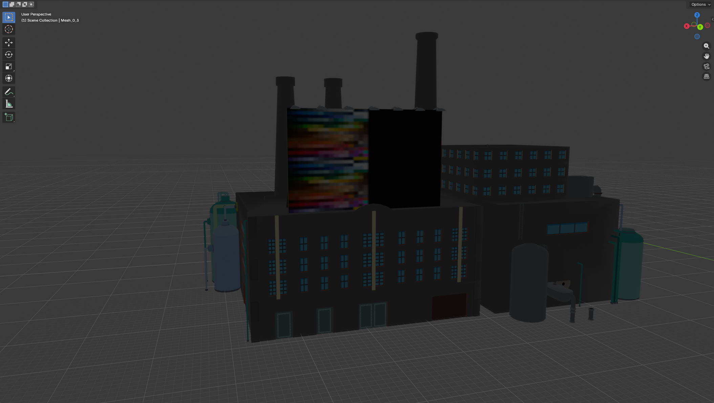
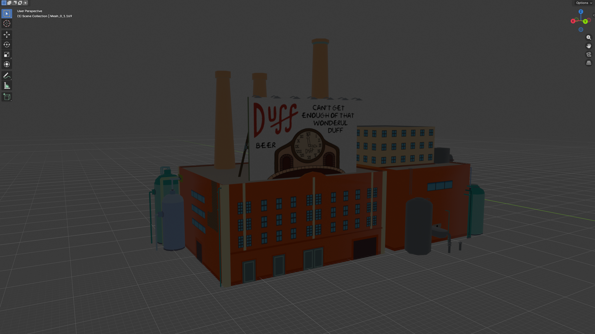
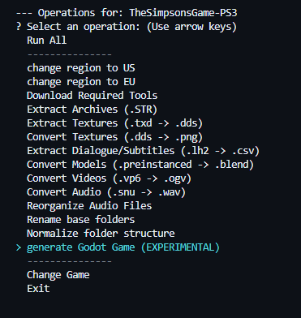
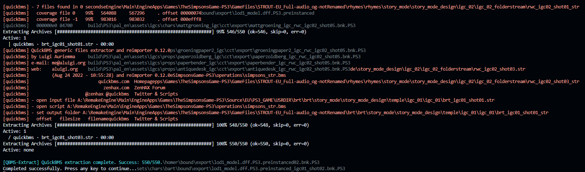
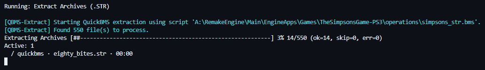
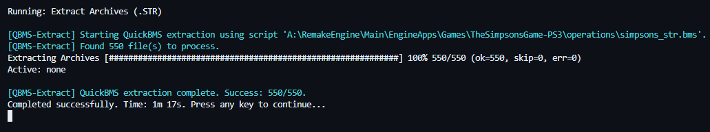

# Remake Engine Game Module: The Simpsons Game (2007, PS3 Edition)


This module re-implements *The Simpsons Game* (2007, PS3 edition) using the [RemakeEngine](https://github.com/yggdrasil-au/RemakeEngine). It converts user-provided assets into formats compatible with the [Godot Engine](https://godotengine.org/) and generates a playable project. **You must own an original copy of the game to use this module.**


## What is This?
This project is a highly automated reverse-engineering toolset and engine remake for *The Simpsons Game (PS3)*.

Rather than distributing copyrighted assets, the `RemakeEngine` automates the process of taking a user's legally dumped PS3 game, extracting the original assets, converting them into standard formats, and assembling them into a playable Godot project. The engine focuses on format conversion, data normalization, and rebuild scripts so contributors can reproduce the game from their own legally obtained files.

Godot provides the runtime (rendering, physics and scripting). This module concentrates on the hard work: parsing proprietary formats, converting game assets (models, textures, audio, video), and rebuilding scene data and mappings so a playable project can be generated automatically.

## Current Status & Known Issues
The module is in active development (Beta). Highlights and known problems:

- **Textures & Models (`Operations 5 & 7`):** Texture extraction (`.txd` -> `.png`) completes reliably, and `.preinstanced` models import into `.blend` and export to `.glb`/`.fbx`. Texture-to-submesh mapping has improved, but it remains imperfect and cannot yet reproduce the exact correct output for complex, high-LOD meshes; low-LOD meshes are almost all accurate.
- **Audio & Music (`Operations 4, 11, 12 & 13`):** Operation `4` (`operations/Audio/SetupAudioDir.lua`) stages English banks under `EN` and global banks under `Global`, sorts streams using `AudioMap.yaml` V2, leaves unresolved files in place, removes empty source folders, and displays live progress. See the [audio consumer contract](reversing/docs/integrations/remake-engine/index.html#audio-map). `.sbk` sound banks (`Operation 11`) and `.snu` streams (`Operation 12`) convert to Godot-compatible `.wav` files, and the 17 `.mus` archives (`Operation 13`, `operations/Audio/SetupMusicFiles.lua` + `operations/mus.bms`) unpack into paired `.snr`/`.sns` streams and decode to `.wav`.
- **Dialogue, Fonts & FMV Subtitles (`Operations 8, 9 & 10`):** `.lh2` localization tables export to `.csv` (`Operation 8`), EA FONT v6 `.inf` descriptors convert to Godot-compatible AngelCode `.fnt` bitmap fonts (`Operation 9`), and `.tox.PS3` timing tables resolve against `.lh2` tables to generate localized `.srt`, `.vtt`, and multilingual `.csv` subtitles (`Operation 10`). Standalone `.alb`/`.smb`/`.lh2` audio-subtitle joins are also mapped via `reversing/audio_subtitles.py`.
- **Video (`Operation 14`):** `.vp6` video files transcode to `.ogv` via FFmpeg for Godot compatibility.
- **Godot Project, Scene Refresh & Native Collision (`Operations 17, 16, 18 & 15`):** Procedural project generation (`godot-init-V0.5.2.lua`) has been superseded by an authored baseline Godot 4 project in `Godot/GodotGame/PreBuilt/`.
  - **Operation `17`** (`operations/godot/CopyGameFilesAssetsToGodot.lua`) populates `PreBuilt/assets/` with converted exports, normalization maps, and source logos.
  - **Operation `16`** (`operations/godot/RefreshGodotTSCNPaths.lua`) refreshes `res://assets/` paths across `.tscn` scenes by matching persistent 6-character asset UIDs from `normalized_map.json`.
  - **Operation `18`** (`operations/godot/BuildLocalVariant.lua`) builds an isolated, disposable Godot project (`Godot/GodotGame/LocalVariant/`) from `PreBuilt`, using `operations/godot/variant_runtime/tsg_havok_reader.gd` and `tsg_character_reader.gd` to directly read PS3 Havok 4.1 packfiles (`.hkt.PS3`, `.hko.PS3`) and character/prop collision files (`.acs.PS3`, `.bbn.PS3`) into native Godot 3D static collision shapes (`ConcavePolygonShape3D`, `BoxShape3D`, `SphereShape3D`, `ConvexPolygonShape3D`).
- **Reversing & Connection Graph (`reversing/`):** `reversing/fileviewer/file_connections.py` (`reversing/fileviewer/connection_explorer/`; the original command remains a compatibility entry point) builds an SQLite index and serves a local web UI displaying cross-file relationships across source and extracted trees (`.STR`, `.ALB`, `.SMB`, `.LH2`, `.SNU`, `.TXD`, `.dat.simgroup`, `.dat.uie`, etc.).


Screenshots showing earlier extraction results (high-LOD texture issues and low-LOD examples) appear further below in this document; they illustrate the remaining material-mapping problem, not guaranteed current behavior for every asset.

If you want to reproduce the current extraction pipeline or help debug mapping, see the `operations/` scripts and the format docs in `reversing/docs`.

## Help Wanted!
This is a large reverse-engineering effort and contributions are welcome. Areas where help would be most valuable:

1. **Texture Mapping:** Validate whether TLFD events delimit material texture groups and how submesh material IDs index those groups; replace the pair heuristic only after checking known-good assets.
2. **Format Documentation:** Expand and improve the format analyses in the [docs repository](https://github.com/Superposition28/TheSimpsonsGame-PS3-Docs/tree/main/).
3. **Blender / Import Pipelines:** Improve Blender automation scripts for robust material assignment and layer handling.

To contribute, open issues or PRs, or jump into the format docs and submit patches. If you want to discuss complex reverse-engineering tasks first, open an issue describing your approach and refer to the relevant `operations/` or `reversing/` files.

## Features

- Converts your legally obtained game assets into Godot-ready formats.
- Generates a Godot project using Python and GDScript.
- Requires possession of the original PlayStation 3 game.

## Goals

- Re-implement the original game logic in GDScript and C#.

## Module Platform Support

- **Current Support:** Windows only
- **Planned Support:** it should theoretically work on Linux and MacOS, but only ever tested on Windows. The engine is cross-platform, but some tools (Blender, QuickBMS, FFmpeg, vgmstream) may be platform-specific.

## Depends On
This module depends on the RemakeEngine, its managed toolchain, and the documentation repo checked out at `reversing/docs` inside this module root.
Tools such as Blender, QuickBMS, Godot, FFmpeg, and vgmstream are declared in `Tools.toml` and are downloaded and managed by RemakeEngine as needed.

## How To Use

This module is intended to be downloaded and executed through the RemakeEngine TUI, CLI or GUI.

> **TUI terminal note:** While an operation is running, do not resize or move the terminal window. RemakeEngine is still in development, and changing the terminal during active output can corrupt or break the TUI display.

### 1. Clone and launch the engine

```pwsh
git clone https://github.com/yggdrasil-au/RemakeEngine.git
cd RemakeEngine
dotnet build RemakeEngine.slnx -c Debug
dotnet run -c Release --framework net10.0 --project EngineNet
```

### 2. Download the game module from the registry

In the TUI, select `gitDownload` from the main game list:

```text
Select a game:
  demo  [registered, installed, unbuilt]
  ---------------
> gitDownload
  Exit
```

Then choose `Download from Registry`:

```text
--- Operations for: gitDownload
? Select an operation: (Use arrow keys)
> Download from Registry
  Download from Git URL
  ---------------
  Change Game
  Exit
```

Select module `2`, `TheSimpsonsGame-PS3`:

```text
Select module from registry:
1. demo (Disabled)
2. TheSimpsonsGame-PS3
3. TheSimpsonsGame-PS2
4. SimpsonsHitAndRun
5. TheSimpsonsRoadRage-PS2
```

Expected output:

```text
Select module from registry:
1. demo (Disabled)
2. TheSimpsonsGame-PS3
3. TheSimpsonsGame-PS2
4. SimpsonsHitAndRun
5. TheSimpsonsRoadRage-PS2
Selection # > 2
Running: Download from Registry

>>> Engine operation: Download from Registry
Downloading 'TheSimpsonsGame-PS3' from 'https://github.com/Superposition28/TheSimpsonsGame-PS3.git'...
Target directory: 'A:\TSG-test\RemakeEngine\EngineApps\Games\TheSimpsonsGame-PS3'
Cloning into 'A:\TSG-test\RemakeEngine\EngineApps\Games\TheSimpsonsGame-PS3'...
Submodule 'TheSimpsonsGame-PS3-Docs' (https://github.com/Superposition28/TheSimpsonsGame-PS3-Docs.git) registered for path 'reversing/docs'
Submodule 'TheSimpsonsGame-PS3-FileViewer' (https://github.com/Superposition28/TheSimpsonsGame-PS3-FileViewer.git) registered for path 'reversing/fileviewer'
Cloning into 'A:/TSG-test/RemakeEngine/EngineApps/Games/TheSimpsonsGame-PS3/reversing/docs'...
Cloning into 'A:/TSG-test/RemakeEngine/EngineApps/Games/TheSimpsonsGame-PS3/reversing/fileviewer'...
Submodule path 'reversing/docs': checked out '8fa61d72af3db0a89883b848e34d50c723c8f131'
Submodule path 'reversing/fileviewer': checked out 'bf256e8dc25924aca21af731639e94c403ae78cd'

Successfully downloaded 'TheSimpsonsGame-PS3'.
Completed successfully. Time: 14.7s.
Press any key to continue...
```

After the download completes, choose `Change Game` to return to the main menu. You should then see `TheSimpsonsGame-PS3` in the list:

```text
Select a game:
  demo  [registered, installed, unbuilt]
> TheSimpsonsGame-PS3  [registered, installed, unbuilt]
  ---------------
  gitDownload
  Exit
```

### 3. Select the module and answer the initialization prompts

When you select `TheSimpsonsGame-PS3`, the engine runs the module initialization step and asks for your game platform, game region, and the path to your dumped game files.

The source path you enter should point at the game root folder that contains `USRDIR`. For example:

```text
Running 1 initialization operation(s) for TheSimpsonsGame-PS3

▶ Starting script: init.lua
Config not found. Creating: A:\TSG-test\RemakeEngine\EngineApps\Games\TheSimpsonsGame-PS3\config.toml
Created config.toml with default placeholders.
Reading module config: A:\TSG-test\RemakeEngine\EngineApps\Games\TheSimpsonsGame-PS3\config.toml
Initialized placeholders.num = "1"
Initialized placeholders.audio_state = "audio_none"
Initialized placeholders.Type = "Full"
No valid Platform set in config.toml. You'll be prompted to set one (PS3 or XBOX 360).
? Enter the game platform (PS3 or XBOX 360) and press Enter (leave blank to cancel):
PS3
Set Platform to 'PS3'.
No valid Region set in config.toml. You'll be prompted to set one (US, EU, or Both).
? Enter the game region (US, EU, or Both) and press Enter (leave blank to cancel):
EU
Set Region to 'EU'.

No MainSourcePath set in config.toml. You'll be prompted to set one.
? Enter the path to your game root (this folder should contain a folder named USRDIR) and press Enter (leave blank to cancel):
A:\RemakeEngine\Main\EngineApps\Games\TheSimpsonsGame-PS3\Source\EU\PS3_GAME
Checking path: 'A:\RemakeEngine\Main\EngineApps\Games\TheSimpsonsGame-PS3\Source\EU\PS3_GAME'
? Permission requested: Allow this script to access external path '"A:\RemakeEngine\Main\EngineApps\Games\TheSimpsonsGame-PS3\Source\EU\PS3_GAME"'? [Y/n]
y
Detected USRDIR under provided path; using 'A:\RemakeEngine\Main\EngineApps\Games\TheSimpsonsGame-PS3\Source\EU\PS3_GAME\USRDIR' as source root.
Will copy folder: 'PS3_GAME'

--- Source Path Handling ---
Validated source path (EU): 'A:\RemakeEngine\Main\EngineApps\Games\TheSimpsonsGame-PS3\Source\EU\PS3_GAME\USRDIR'
Local project data path: 'A:\TSG-test\RemakeEngine\EngineApps\Games\TheSimpsonsGame-PS3\Source\EU'
? Choose how to use the source files:
1) Copy folder 'PS3_GAME' into local 'EU' (Recommended, Safe)
2) Move folder 'PS3_GAME' into local 'EU' (Warning: Deletes originals)
3) Use original path 'PS3_GAME' directly (Warning: Tools may modify original files)

Enter your choice (1, 2, or 3):
1
...
══════════════════════════════════════════════════════════════════════════════════════════════════════════════════════════════════════════════════════════════════════════════════════════════════════════════════════════════════════════════════════════════════════════════Copying 30190 files... [====================>                                       ] 35% 10549/30190 (ok=10549, skip=0, err=0)
Active: none

Copy complete.
  Updating config.toml with effective Source Path...
  Config updated.

Validating final source location: 'A:\TSG-test\RemakeEngine\EngineApps\Games\TheSimpsonsGame-PS3\Source\EU\PS3_GAME\USRDIR'
All 23 required 'USRDIR_DIRS_ORIGINAL' subdirectories found in 'A:\TSG-test\RemakeEngine\EngineApps\Games\TheSimpsonsGame-PS3\Source\EU\PS3_GAME\USRDIR'.
Success: Source validated and saved: A:\TSG-test\RemakeEngine\EngineApps\Games\TheSimpsonsGame-PS3\Source\EU\PS3_GAME\USRDIR
◀ Finished script: Unnamed
Initialization completed successfully. Time: 40.5s. Press any key to continue...
```

Once initialization completes, the module operations menu becomes available.

### Non-interactive initialization

Operation `0` accepts optional Lua arguments for every initialization prompt. Omitted values keep the interactive behavior; supplied values are validated and used without prompting.

```pwsh
dotnet run -c Debug --project .\EngineNet\ -- `
  --game TheSimpsonsGame-PS3 `
  --run_op 0 `
  --args '["--platform","ps3","--region","EU","--path","D:\\Dump\\PS3_GAME","--action","use"]'
```

Use `--platform` (`PS3` or `XBOX360`), `--region` (`EU`, `US`, or `BOTH`), `--path` (also `--MainSourcePath`), and `--action` (`copy`, `move`, or `use`). For `BOTH`, provide `--us-path` and `--us-action` for the US source. The engine requires these script arguments in a JSON array supplied to `--args`.

### 4. Run the pipeline

After initialization, the operations menu looks like this:

```text
--- Operations for: TheSimpsonsGame-PS3
? Select an operation: (Use arrow keys)
> Run All
  ---------------
  Download Required Tools
  Extract Archives (.STR)
  Copy Source Audio/Video Files
  Rename base folders
  Reorganize Audio Files
  Extract Textures (.txd -> .png)
  Normalize folder structure
  Convert Models (.preinstanced -> .blend)
  Extract Dialogue/Subtitles (.lh2 -> .csv)
  Convert Fonts (.inf -> .fnt)
  Convert FMV Subtitles (.tox.PS3 -> .srt/.vtt/.csv)
  Convert Audio (.sbk -> .wav)
  Convert Audio (.snu -> .wav)
  Convert Music (.mus -> .snr/.sns -> .wav)
  Convert Videos (.vp6 -> .ogv)
  Copy GameFiles Assets to Godot
  Refresh Godot Scene Asset Paths (.tscn)
  Build Isolated Local Godot Variant
  generate game.toml
  RESET GAME MODULE, This will delete all generated files and reset the game module to its original state, or move them to .backup/<dateTime> folder
  ---------------
  Change Game
  Exit
```

For a full pipeline run, select `Run All`. If you are debugging a specific step, you can execute the operations individually from this menu; most will require their prerequisite steps to have been completed first.

### 5. What the pipeline produces

- Extracted and normalized game data under `GameFiles/` with persistent 6-character asset UIDs (`normalized_map.json`)
- Converted textures (`.png`), audio/music (`.wav`), and video (`.ogv`) outputs
- Blender `.blend` files and exported `.glb`/`.fbx` models for `.preinstanced` assets
- CSV exports for `.lh2` dialogue/subtitle files
- Localized SRT/WebVTT subtitles and multilingual timing CSV files for `.tox.PS3` FMV tables
- Godot-compatible AngelCode `.fnt` descriptors for `.inf` bitmap fonts, referencing the extracted PNG atlases
- Populated and path-refreshed Godot scenes in `Godot/GodotGame/PreBuilt/`, plus an optional isolated variant project (`Godot/GodotGame/LocalVariant/`) with imported Havok/ACS collision via Operation `18`


## File Breakdown

- `config/`
  - `config/RenameMap.db` - SQLite database mapping original folder names (`PS3`, `XBOX360`, `DEMO`) to canonical human-readable names.

- `GameFiles/` - Generated extraction, normalization, and conversion outputs created by the pipeline.

- `Godot/`
  - `GodotGame/PreBuilt/` - Canonical authored Godot 4 project containing level, hub, character, and UI `.tscn` scenes, GDScript controllers, and the `tsg_graph_importer` addon.
  - `GodotGame/LocalVariant/` - Disposable local Godot project generated by Operation `18` (`BuildLocalVariant.lua`) with adapted scenes and baked PS3 collision.

- `operations/` - Core operation scripts (Lua, BMS, Python/Blender, GDScript):
  - `Audio/` - `SetupAudioDir.lua` (`AudioMap.yaml` V2 organizer) and `SetupMusicFiles.lua` (`.mus` extractor/converter).
  - `Blender/` - Headless Blender conversion driver (`run.lua`, `BlenderCore.lua`), SQLite symlink batching, and `.preinstanced` importer addon.
  - `Converters/` - `lh2_to_csv.lua` (Operation `8`), `inf_to_fnt.Fonts.lua` (Operation `9`), and `tox_to_srt.Subtitles.lua` (Operation `10`).
  - `DirectoryNormalizer/` - Folder flattening and persistent 6-character UID generation (`run.lua`, `logic.lua`, `tests.lua`).
  - `godot/` - Godot asset copy (`CopyGameFilesAssetsToGodot.lua`), scene path refresher (`RefreshGodotTSCNPaths.lua`), isolated variant builder (`BuildLocalVariant.lua`, `local_variant/`), and GDScript Havok/ACS collision readers (`variant_runtime/`).
  - `init/` - Initialization, CLI argument parsing, and `PARAM.SFO` validation (`main.lua`, `core.lua`, `cli.lua`, `util.lua`).
  - `simpsons_str.bms` & `mus.bms` - QuickBMS extraction scripts for `.str` and `.mus` archives.
  - `generate-game-toml.lua` & `resetThisBih.lua` - Launch manifest generator (Operation `15`) and module reset/backup utility (Operation `6677`).

- `reversing/` - Reverse-engineering utilities and submodules:
  - `docs/` - Reverse-engineering documentation repository submodule ([TheSimpsonsGame-PS3-Docs](https://github.com/Superposition28/TheSimpsonsGame-PS3-Docs)) and `PS3_GAME/USRDIR/A1_Audio/AudioMap.yaml`.
  - `fileviewer/connection_explorer/` & `fileviewer/file_connections.py` - Integrated SQLite indexer and local web UI for exploring source/extracted file links; start/stop controls are available in the desktop viewer. `file_connections.py` preserves the original CLI entry point.
  - `audio_subtitles.py`, `str_audit.py`, `test_str_extraction.py`, `validate_txd_exports.py`, `sfo.toml.py`, `preinstanced_viewer.py` - Standalone verification and analysis scripts.
  - `fileviewer/`, `TSGFileViewer/`, `TheSimpsonsGameFileExtractor-main/` - Supporting reference viewers and extractors.

- `Source/` - Local copy of user-provided game files (if copied/moved).
- `.gitignore` - Ignore rules for assets and outputs.
- `blank.blend` - Blank Blender file for model conversion.
- `config.toml` - Module-local configuration (stores `SourcePath` and active placeholders).
- `operations.toml` - Defines the sequence of asset-processing operations.
- `Readme.md` - This file.
- `TODO.md` - Tracked module cleanup and architectural tasks.
- `Tools.toml` - Configuration for external tools managed by RemakeEngine.

### Path Placeholders

RemakeEngine operations use built-in placeholders for paths and configuration. These are provided by the engine, initialized by `operations/init/main.lua`, and updated by follow-up config steps defined in `operations.toml`.

**Built-in placeholders for `operations.toml`:**

* `{{Game_Root}}` — Path to this module's root directory.
* `{{Project_Root}}` — Path to the RemakeEngine root project directory.

**Key custom placeholders defined in `config.toml`:**

* `{{SourcePath}}` — Path to your local or external game source root (set by `operations/init/main.lua` and stored in `config.toml`).
* `{{MainSourcePath}}` — Validated `USRDIR` path used during initialization and logo discovery.
* `{{PostSourcePath}}` — Subpath appended under `{{SourcePath}}/{{Region}}` when targeting the game data root (e.g. `1/PS3_GAME/USRDIR`).
* `{{Platform}}` — Game platform, e.g. `PS3` or `XBOX360`.
* `{{Region}}` — Game region, e.g. `EU`, `US`, or `DEMO`.
* `{{Type}}` — Extraction/structure type (`Full` initially; updated to `FullFlattened` after normalization).
* `{{audio_state}}` — Audio layout state (`audio_none` -> `audio_og` -> `audio_reorg`).
* `{{isRenamed}}` — Base folder rename state (`notRenamed` -> `isRenamed`).

**Usage:**
- Placeholders are referenced in TOML and scripts as `{{PlaceholderName}}`.
- They are resolved by the engine before running each operation.
- Example: `args = ["{{Game_Root}}/GameFiles/{{Platform}}-{{Region}}-{{Type}}-{{audio_state}}-{{isRenamed}}", "--map-db-file", "{{Game_Root}}/config/RenameMap.db"]`
- The current pipeline uses these placeholders to build the active `GameFiles/`, symlink, and Godot asset paths.

**Note:** The placeholder format is always double curly braces, e.g. `{{SourcePath}}`.

This module is fully automated and designed to be executed by [The Remake Engine](https://github.com/yggdrasil-au/RemakeEngine). All direct dependencies (Godot, Blender, QuickBMS, FFmpeg, vgmstream, etc.) are defined by `Tools.toml` and handled by RemakeEngine. **This module is in beta.**

### Operations Overview
- **Init (`0`):** `operations/init/main.lua` creates or updates `config.toml`, validates `PARAM.SFO`, and ensures required placeholders exist.
- **Download required tools (`-1`):** Engine `download-tools` reads `Tools.toml`.
- **Extract archives (`1`):** `operations/simpsons_str.bms` extracts `.str` archives into `GameFiles/`, tagging identified `.dat.simgroup` and `.dat.uie` payloads.
- **Copy source audio/video (`2`):** `operations/CopySourceAudioVideo.lua` copies `audiostreams` and `movies` into the working `GameFiles/` tree and sets `audio_state=audio_og`.
- **Rename base folders (`3`):** Engine `rename-folders` uses `config/RenameMap.db` and sets `isRenamed=isRenamed`.
- **Reorganize audio (`4`):** `operations/Audio/SetupAudioDir.lua` stages loose English banks under `EN` and mapped global banks under `Global`, then sorts by speaker/type/location using `AudioMap.yaml` V2 and sets `audio_state=audio_reorg`. See the [audio consumer contract](reversing/docs/integrations/remake-engine/index.html#audio-map).
- **Extract textures (`5`):** Engine `format-extract` converts `.txd` texture dictionaries into `.png` outputs.
- **Normalize folder structure (`6`):** `operations/DirectoryNormalizer/run.lua` flattens redundant folder nesting, assigns deterministic 6-character UIDs from canonical renamed paths, emits `normalized_map.json` / `map_*.json`, and sets `Type=FullFlattened`. See the [UID compatibility contract](operations/DirectoryNormalizer/README.md).
- **Convert models (`7`):** `operations/Blender/run.lua` imports `.preinstanced` assets into `.blend` files and exports `.glb`/`.fbx` models.
- **Extract dialogue/subtitles (`8`):** `operations/Converters/lh2_to_csv.lua` converts `.lh2` localization files to `.csv`.
- **Convert fonts (`9`):** `operations/Converters/inf_to_fnt.Fonts.lua` converts EA FONT v6 `.inf` descriptors to Godot-compatible AngelCode `.fnt` files beside each `.inf`.
- **Convert FMV subtitles (`10`):** `operations/Converters/tox_to_srt.Subtitles.lua` resolves `.tox.PS3` timing IDs against `.lh2` tables and writes `.srt`, `.vtt`, and multilingual `.csv` files (plus movie companions under `A1_Video/<language>/`).
- **Convert audio & music (`11`, `12`, `13`):** Engine `format-convert` converts `.sbk` (`11`) and `.snu` (`12`) streams to `.wav`; `operations/Audio/SetupMusicFiles.lua` (`13`) unpacks `.mus` archives with `operations/mus.bms` and converts `.snr`/`.sns` streams to `.wav`.
- **Convert videos (`14`):** Engine `format-convert` transcodes `.vp6` movies to `.ogv`.
- **Copy GameFiles assets to Godot (`17`):** `operations/godot/CopyGameFilesAssetsToGodot.lua` copies `.png`, `.glb`, `.ogv`, `.graph`, `.fnt`, and `.json` maps into `Godot/GodotGame/PreBuilt/assets/`, plus missing source logos.
- **Refresh Godot scene asset paths (`16`):** `operations/godot/RefreshGodotTSCNPaths.lua` updates `res://assets/` paths in `Godot/GodotGame/PreBuilt/**/*.tscn` using `normalized_map.json` (or `map_*.json`) by asset UID and strips stale Godot UID hints when paths change.
- **Build isolated local Godot variant (`18`, optional):** `operations/godot/BuildLocalVariant.lua` builds `Godot/GodotGame/LocalVariant/` from `PreBuilt`, importing original PS3 Havok (`.hkt.PS3`, `.hko.PS3`) and character/prop (`.acs.PS3`, `.bbn.PS3`) collision.
- **Generate launch manifest (`15`):** `operations/generate-game-toml.lua` writes `game.toml`.
- **Reset game module (`6677`, manual):** `operations/resetThisBih.lua` backs up (to `.backup/<timestamp>`) or deletes generated files to restore a clean state.

---

### Font conversion (Operation `9`)

From the engine repository root, run the font operation for the configured platform and region:

```pwsh
dotnet run -c Debug --project .\EngineNet\ -- --game_module TheSimpsonsGame-PS3 --run_op 9
```

`operations/Converters/inf_to_fnt.Fonts.lua` writes each `.fnt` beside its `.inf`. It strips extraction hash suffixes when matching PNG atlases, prefers textures from the same archive, and writes relative PNG references with forward slashes. Raw glyph IDs, signed bearings, surviving kerning pairs, extended Unicode aliases, and button-icon aliases (`U+E000..U+E020`) are preserved.

To choose another input or output directory, override the operation arguments:

```pwsh
dotnet run -c Debug --project .\EngineNet\ -- --game_module TheSimpsonsGame-PS3 --run_op 9 --args '["--input-dir", "{{Game_Root}}/GameFiles/PS3-EU-FullFlattened-audio_reorg-isRenamed", "--output-dir", "{{Game_Root}}/TMP/fonts", "--copy-png"]'
```

`--input-dir`/`-i` selects the asset root; `--output-dir`/`-o` gathers descriptors into one directory. `--copy-png` copies matching atlases beside the descriptors. `--no-unicode-aliases` emits only original byte IDs. Invalid font data, missing atlases, and invalid PNG headers fail the operation.

### FMV subtitle conversion (Operation `10`)

From the engine repository root, run the subtitle operation for the configured asset directory:

```pwsh
dotnet run -c Debug --project .\EngineNet\ -- --game_module TheSimpsonsGame-PS3 --run_op 10
```

`operations/Converters/tox_to_srt.Subtitles.lua` reads EA `1BOT` timing tables and resolves their string IDs through the first non-empty, sorted `simpsons_global.{en,es,fr,it,ss}.LH2` tables. It decodes Windows-1252 text and writes English, Spanish, French, and Italian subtitles beside each timing file. The CSV retains all timing records; SRT/VTT omit blank translations. Matching `.ogv` and `.vp6` files under `A1_Video/<language>/` also receive subtitle companions.

Override operation arguments with `--args` to use `--input-dir`/`-i`, gather output with `--output-dir`/`-o`, disable video companions with `--no-video-pairing`, or add speaker codes with `--include-speaker`.

### Godot Scene Refresh & Isolated Local Variant (Operations `17`, `16` & `18`)

After asset conversion completes, copy the assets into `Godot/GodotGame/PreBuilt/assets` and refresh `.tscn` scene references:

```pwsh
dotnet run -c Debug --project .\EngineNet\ -- --game_module TheSimpsonsGame-PS3 --run_op 17
dotnet run -c Debug --project .\EngineNet\ -- --game_module TheSimpsonsGame-PS3 --run_op 16
```

To build an isolated local variant project (`Godot/GodotGame/LocalVariant/`) with PS3 collision imported into the level scenes:

```pwsh
dotnet run -c Debug --project .\EngineNet\ -- --game_module TheSimpsonsGame-PS3 --run_op 18
```

Operation `18` (`operations/godot/BuildLocalVariant.lua`) stages an isolated project copy and uses the GDScript readers under `operations/godot/variant_runtime/`:
- **Havok 4.1 Packfile Reader (`tsg_havok_reader.gd`):** Reads big-endian `Hkx`-wrapped `Havok-4.1.0-r1` `.hkt.PS3` and `.hko.PS3` files, resolving `__classnames__` and `__data__` fixups to decode `EAStorageMeshShape`, `hkBoxShape`, `hkSphereShape`, `hkConvexVerticesShape`, `hkMoppBvTreeShape` child references, and `hkRigidBody` world transforms into native Godot `StaticBody3D` + `CollisionShape3D` nodes.
- **Character & Prop ACS/BBN Reader (`tsg_character_reader.gd`):** Reads `.acs.PS3` record tables, resolves SDBM hash bindings via `.bbn.PS3` rig/alias tables, and inspects RenderWare `.preinstanced` `FrameList` + `HAnim` hierarchies.

### Reversing & File Connection Explorer (`reversing/`)

To build the cross-file connection SQLite index (`GameFiles/file-connections/index.sqlite`) and open the local web explorer UI:

```pwsh
python -B reversing/file_connections.py --open
```

Additional standalone analysis and verification scripts:
- `python -B reversing/audio_subtitles.py` — Audits and links `.alb`, `.smb`, `.lh2`, and `.snu` dialogue/subtitle records (see `reversing/audio_subtitles.md`).
- `python -B reversing/str_audit.py` & `python -B reversing/test_str_extraction.py` — Audits `.str` archive sections and extraction bounds.
- `python -B reversing/sfo.toml.py` — Exports `PARAM.SFO` metadata to documented TOML.

## Reverse Engineering & Format Documentation

For technical details and reverse-engineering notes on the file formats used in *The Simpsons Game* (PS3), see the documentation submodule checked out at `reversing/docs`:

- [TheSimpsonsGame-PS3-Docs README](https://github.com/Superposition28/TheSimpsonsGame-PS3-Docs/blob/main/readme.md) -- Overview of the documentation repository layout and maintenance checks.
- [Format Analysis](https://github.com/Superposition28/TheSimpsonsGame-PS3-Docs/blob/main/PS3_GAME/FormatAnalysis/index.html) -- Landing page for format-specific analyses, including audio, RenderWare assets, Havok collision, and embedded `.STR` formats.
- [PS3 Game Layout](https://github.com/Superposition28/TheSimpsonsGame-PS3-Docs/blob/main/PS3_GAME/index.html) -- Disc layout documentation and links into `USRDIR` content.

These resources provide:

- Format breakdowns for `.snu`, `.mus`, `.str`, `.vp6`, and more.
- Links to detailed reverse-engineering notes for each format.
- Game-specific file layout documentation for `PS3_GAME/USRDIR`.
- Guidance for contributing new format analyses or deduplicating documentation.

---

## Obligatory Legal Disclaimer

This project automates extraction of assets (3D models, sounds, videos) from *The Simpsons Game* 2007 (PS3 edition) for personal use only--hobby projects, learning, research, etc.--not for commercial distribution.

**Key Points:**

- **Requires Ownership of the Game:** You must possess your own legally obtained ISO copy of the game for PlayStation 3. This tool does not provide game files.
- **Respect Copyright:** Extracted assets are copyrighted by Electronic Arts (EA) and Disney. Use is limited to personal exploration and modification of assets from a game you legally own. You are responsible for compliance with copyright laws and the game's EULA/Terms of Service where applicable.
- **No Distribution of Assets:** This project does not distribute copyrighted game assets. It only provides code to automate extraction from your own files and should not be used to share or distribute game content.

**By using this project, you acknowledge that you have read and understood this disclaimer and agree to use it responsibly and in accordance with all applicable laws and terms of service.**

---
---

GameFiles\PS3-EU-FullFlattened-audio_reorg-isRenamed\LHub-00_SprHub\sprHub\zone08str\assets\environs\sprIndustrialBldgDuffBreweryGeo\exportBldgDuffBrewery

High LOD model with broken textures

low LOD model with working textures


gotta love that, especially since the textures are applied mostly randomly, but repeatably it will always be the same random texture applied to the same model.
i assume low lod models have less layers and less overall textures so my script is more likely to apply the correct textures to the low lod models?

---
---


---
Extract Archives (.STR)


---


---
---

